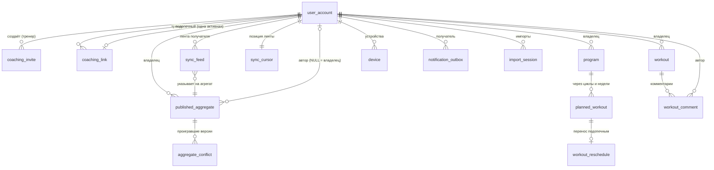
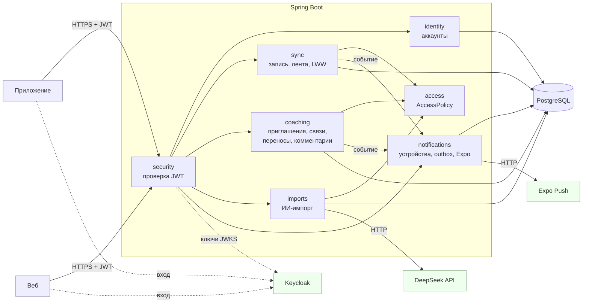
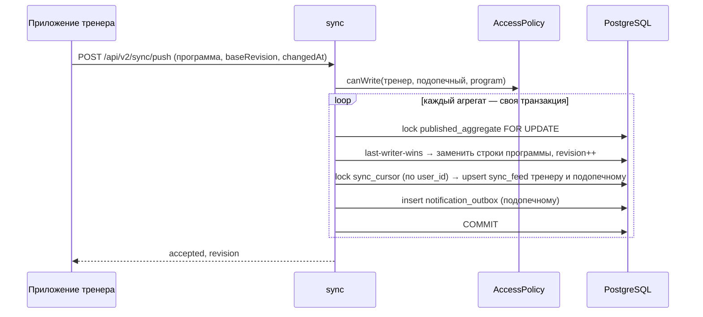
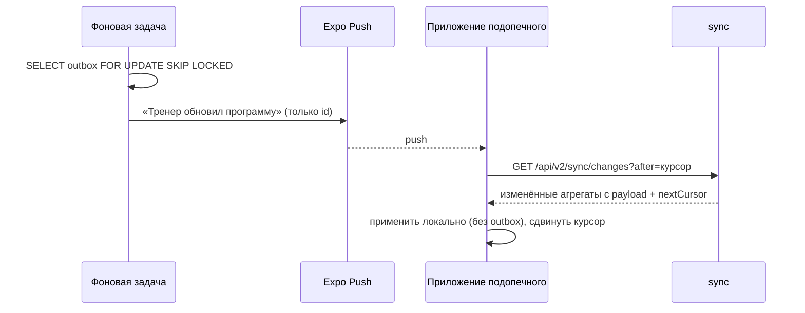

# ADR-0010: Модель данных и архитектура сервера

Статус: предложено
Дата: 23 октября 2026
Сводит вместе [ADR-0007](0007-two-way-sync-and-coaching.md) (синхронизация и данные тренера),
[ADR-0008](0008-ai-program-import.md) (ИИ-импорт) и [ADR-0009](0009-push-notifications.md)
(push-уведомления). Механизмы описаны там, здесь — общая картина: какие таблицы есть, как они
связаны и из каких частей состоит сервер.

## 1. Модель данных

Все таблицы — в схеме `sizylift` PostgreSQL. Схемой владеет Liquibase: новые таблицы и колонки
добавляются новыми changeset'ами, существующие changeset'ы не меняются.

### Группы таблиц

| Группа                | Таблицы                                                                                                                                                                     | Статус        |
| --------------------- | --------------------------------------------------------------------------------------------------------------------------------------------------------------------------- | ------------- |
| Аккаунты              | `user_account` (+ колонка `coach_enabled`)                                                                                                                                   | меняется      |
| Каталог упражнений    | `exercise_catalog_version`, `movement_category`, `equipment`, `muscle_group`, `exercise`, `exercise_muscle`, `exercise_equipment`                                            | без изменений |
| Данные пользователя   | факт: `workout`, `workout_block`, `workout_exercise`, `workout_set`, `workout_plan_set_snapshot`, `workout_record_event`; план: `program`, `program_cycle`, `training_week`, `planned_workout`, `planned_block`, `planned_exercise`, `planned_set`; прочее: `athlete_profile`, `one_rep_max`, `injury`, `contraindication` | без изменений |
| Состояние агрегатов   | `published_aggregate` (+ `revision`, `changed_at`, `author_user_id`, `source_client_id`, `source_version`), `aggregate_conflict`                                             | меняется, новая |
| Тренер и подопечный   | `coaching_invite`, `coaching_link`                                                                                                                                           | новые         |
| Данные «между двумя»  | `workout_reschedule`, `workout_comment`                                                                                                                                      | новые         |
| Синхронизация         | `sync_cursor`, `sync_feed`                                                                                                                                                   | новые         |
| Уведомления           | `device`, `notification_outbox`                                                                                                                                              | новые         |
| Импорт                | `import_session`                                                                                                                                                             | новая         |

### Связи

### Ключевая идея: владелец, автор и ревизия

- **Строки данных** (тренировки, программы и их дети) по-прежнему лежат под `user_id`
  **владельца** с ключами `(user_id, id)`. Id приходят из приложения.
- **Программа тренера** хранится под `user_id` подопечного: подопечный её владелец, тренировки
  ссылаются на неё как на любую свою. Кто имеет право её писать, хранится не в строках данных,
  а в `published_aggregate.author_user_id`.
- **`published_aggregate`** — одна строка на агрегат. В ней ревизия, время правки, автор и
  последний клиент-писатель. Это точка блокировки и сравнения при записи (ADR-0007, раздел 3).
- **Лента** (`sync_feed`) не хранит данные, только указатель «агрегат X владельца Y изменился,
  ревизия N» для конкретного получателя. Payload собирается из таблиц данных при чтении.

### Новые таблицы

| Таблица               | Ключ                                       | Колонки (главное)                                                                                                       | Пишет                     | Зачем                                                                    |
| --------------------- | ------------------------------------------ | ----------------------------------------------------------------------------------------------------------------------- | ------------------------- | ------------------------------------------------------------------------ |
| `coaching_invite`     | `id`; `UNIQUE (token_hash)`                | `coach_user_id`, `token_hash bytea`, `expires_at`, `accepted_at`, `accepted_by`                                          | тренер                    | одноразовая ссылка-приглашение; хранится только SHA-256 токена           |
| `coaching_link`       | `id`; частичный `UNIQUE (athlete_user_id) WHERE ended_at IS NULL` | `coach_user_id`, `athlete_user_id`, `health_access`, `created_at`, `ended_at`                      | обе стороны (разрыв), подопечный (`health_access`) | связь и доступ к травмам; один активный тренер у подопечного |
| `workout_reschedule`  | `(user_id, planned_workout_id)`; FK на `planned_workout` с каскадом | `program_id`, `scheduled_date`, `changed_at`                                                 | подопечный                | перенос тренировки тренера без правки самой программы                     |
| `workout_comment`     | `(user_id, id)`; FK `(workout_owner_id, workout_id)` на `workout` с каскадом | `user_id` = автор, `workout_owner_id`, `workout_id`, `text`, `created_at`, `updated_at`, `deleted` | автор               | комментарии к тренировке                                                  |
| `aggregate_conflict`  | `id`                                       | `user_id`, `type`, `aggregate_id`, `lost_payload jsonb`, `lost_changed_at`, `lost_client_id`, `winner_revision`, `created_at` | сервер            | проигравшие при last-writer-wins версии, 30 дней                          |
| `sync_cursor`         | `user_id`                                  | `last_seq`                                                                                                              | сервер                    | счётчик ленты; блокировка строки упорядочивает ленту                     |
| `sync_feed`           | `(user_id, seq)`; `UNIQUE (user_id, owner_user_id, type, aggregate_id)` | `owner_user_id`, `type`, `aggregate_id`, `revision`, `kind` (`upsert`/`delete`/`revoke`) | сервер       | что изменилось для получателя, одна строка на агрегат                    |
| `device`              | `id` (= `clientId` приложения)             | `user_id`, `platform`, `push_token`, `last_seen_at`                                                                     | приложение                | push-токены и идентификатор клиента для идемпотентности записи           |
| `notification_outbox` | `id`                                       | `user_id`, `kind`, `data jsonb` (только id), `attempts`, `next_attempt_at`, `sent_at`, `ticket_ids`                    | сервер                    | очередь push в той же транзакции, что и изменение                        |
| `import_session`      | `id`                                       | `user_id`, `target_owner_id`, `source`, `input`, `status`, `rounds jsonb`, `draft jsonb`, `tokens_in/out`, `expires_at` | сервер                   | вопросы и черновик ИИ-импорта, сутки                                      |

`published_aggregate.type` получает два новых значения: `workout_reschedule` и
`workout_comment`. Переносы и комментарии синхронизируются, проверяются по правам и решают
конфликты так же, как остальные агрегаты.

### Индексы, которые нужны с первого дня

- `coaching_link (coach_user_id) WHERE ended_at IS NULL` — список подопечных и фан-аут тренеру.
- `sync_feed (user_id, seq)` — первичный ключ, по нему идёт чтение ленты.
- `workout_comment (workout_owner_id, workout_id)` — комментарии тренировки.
- `notification_outbox (next_attempt_at) WHERE sent_at IS NULL` — выборка очереди.
- `import_session (user_id, created_at)` — суточный лимит.
- `exercise USING gin (name gin_trgm_ops)` — нечёткое сопоставление упражнений при импорте
  (расширение `pg_trgm`).

### Удаление и каскады

- Удаление аккаунта: каскадом уходят все его строки, включая связи, ленту, устройства и импорты.
- Подопечный удалил тренировку → каскадом удаляются её комментарии. Для каждого удалённого
  комментария в ленты пишется `delete`, чтобы копии на телефонах тоже исчезли.
- Тренер удалил плановую тренировку → каскадом удаляется её перенос.
- Разрыв связи ничего не удаляет из данных подопечного. Тренеру — `revoke` в ленту,
  программы тренера переходят подопечному.

## 2. Архитектура сервера

### Компоненты

Один процесс Spring Boot (модульный монолит), пакеты по функциональности, внутри —
`controller → service → repository`, как сейчас.

| Пакет           | Что делает                                                                                           | Сейчас                                 |
| --------------- | ---------------------------------------------------------------------------------------------------- | -------------------------------------- |
| `security`      | resource server: подпись, срок, `iss`, `aud`                                                          | есть                                   |
| `identity`      | аккаунт по токену, флаг `coach_enabled`                                                               | есть, расширяется                      |
| `sync`          | `push` и `changes`, ревизии и last-writer-wins, фан-аут в ленты, сборка payload (`AggregateReader`)  | вырастает из `publication`; v1 остаётся |
| `access`        | `AccessPolicy`: кто кого читает и пишет                                                               | новый                                  |
| `coaching`      | приглашения, связи, `health_access`, разрыв; переносы и комментарии как агрегаты через `sync`          | новый                                  |
| `imports`       | сессии импорта, разбор таблиц, вызов модели, детерминированная сборка черновика                       | новый                                  |
| `notifications` | устройства, outbox, отправка в Expo, квитанции                                                        | новый                                  |
| `observability` | метрики, трейсы, логи (OpenTelemetry)                                                                 | есть                                   |

**Зависимости между пакетами** идут в одну сторону:
- `access` ни от кого не зависит, кроме своих репозиториев;
- `notifications` получает события через сервисный метод «поставить уведомление» в текущей
  транзакции и ничего не знает о тренировках.

Spring Modulith для проверки границ можно подключить позже. Пакетов пока немного.

### Основные потоки

**Запись правки (тренер нажал «Скорректировать»)**

**Доставка подопечному**

**ИИ-импорт.** `POST /api/v2/imports`:
1. сессия пишется в БД;
2. модель вызывается вне транзакции;
3. в ответе вопросы или черновик.

Ответы на вопросы идут в `POST /imports/{id}/answers`. Черновик сохраняет клиент, обычной
записью через `sync`.

### Развёртывание

Без изменений (`docs/deployment.md`): один сервер, Docker Compose, Caddy, бэкенд, Keycloak,
две PostgreSQL, `otel-lgtm`. Новые секреты окружения — `DEEPSEEK_API_KEY` и
`EXPO_ACCESS_TOKEN`. Новые исходящие соединения — к API DeepSeek, Expo и `docs.google.com`.
Бэкенд stateless, кроме фоновых задач. Фоновые задачи берут работу через `SKIP LOCKED`,
поэтому второй экземпляр можно добавить без изменений кода.

### Чего в архитектуре нет и почему

- **Брокера сообщений** — очереди и лента лежат в PostgreSQL и пишутся атомарно с данными
  (ADR-0007).
- **Отдельных сервисов** — одна команда, один процесс, общая транзакция нужна почти везде.
- **Кеша вроде Redis** — лента и чтение по индексам; появится, только если метрики покажут
  нужду.
